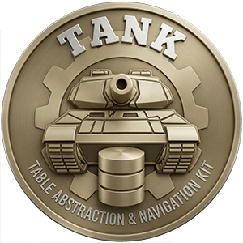

<div align="center">
    
</div>

# Tank

**Tank (Table Abstraction & Navigation Kit)**: the Rust data layer

[](https://crates.io/crates/tank)
[](https://docs.rs/tank)
[](LICENSE)

📘 **Docs:** https://tankhq.github.io/tank

🖥️ **Repo:** https://github.com/TankHQ/tank

📦 **Crate:** https://crates.io/crates/tank

Tank lets you define a Rust struct once with `#[derive(Entity)]` and run typed, streaming queries across relational, analytical, document, wide-column, and key-value databases without rewriting your data model or giving up control over the queries being executed.

## Supported Databases

All drivers live in separate crates behind `tank-core` traits and are validated against the same shared integration suite (`tank-tests`):

- [Postgres](https://crates.io/crates/tank-postgres)
- [SQLite](https://crates.io/crates/tank-sqlite)
- [MySQL / MariaDB](https://crates.io/crates/tank-mysql)
- [DuckDB](https://crates.io/crates/tank-duckdb)
- [MongoDB](https://crates.io/crates/tank-mongodb)
- [ScyllaDB / Cassandra](https://crates.io/crates/tank-scylladb)
- [Valkey / Redis](https://crates.io/crates/tank-valkey)

See the [Capabilities Matrix](https://tankhq.github.io/tank/04-capabilities.html) for per-driver feature support and engine caveats.

## Design Principles

- **One entity definition, zero setup**: Derive `Entity` on a plain Rust struct to get table creation, upserts, inserts, typed queries, and row decoding. No schema CLI or external build step required.
- **Explicit queries with `expr!`**: Filter, project, order, and join using typed Rust expressions compiled into an AST that each driver translates into its native dialect. Drop down to raw SQL or CQL whenever you want.
- **Streaming by default**: Query results stream asynchronously rather than buffering whole result sets up front. Where a database provides native bulk ingestion (Postgres, SQLite, DuckDB), Tank uses it.
- **Extensible driver model**: Database support lives behind `Driver`, `Connection`, `Executor`, `Prepared`, and `SqlWriter` traits. You can write a [custom driver](https://tankhq.github.io/tank/10-drivers.html) for another SQL or NoSQL store without touching `tank-core`.
- **Rich type mapping**: Built-in conversions for standard Rust types, decimals, dates, UUIDs, intervals, JSON, arrays, and maps, plus `AsValue` for custom types. Network drivers support TLS when configured in the connection URL.

## No-Fly Zone

Some features are deliberately out of scope:

- **No schema migrations**: Tank creates and drops tables for fast setup, tests, and prototypes, then stays out of the way of dedicated migration tools.
- **No implicit joins or nested entities**: Entities never hold other entities as fields. Joins are explicit via `join!`, so an innocent field access will never hide an N+1 query.

## Operational Guide

*Looking for more patterns? See the [cheat sheet](https://tankhq.github.io/tank/00-cheat-sheet.html).*

<!-- #region getting-started -->
1) Arm your cargo
```sh
cargo add tank
cargo add tokio --features macros,rt-multi-thread
```

2) Choose your battlefield

Check the [drivers list](https://tankhq.github.io/tank/01-introduction.html#drivers) and pick the one matching your terrain. This example uses DuckDB so you can run it locally with zero setup.
```sh
cargo add tank-duckdb
```

3) Define unit schematics
```rust
use std::borrow::Cow;
use tank::{Entity, Result};

#[derive(Entity)]
#[tank(schema = "army")]
pub struct Tank {
    #[tank(primary_key)]
    pub name: String,
    pub country: Cow<'static, str>,
    #[tank(name = "caliber")]
    pub caliber_mm: u16,
    #[tank(name = "speed")]
    pub speed_kmh: f32,
    pub is_operational: bool,
    pub units_produced: Option<u32>,
}
```

4) Fire a query
```rust
use std::collections::HashSet;
use tank::{ConnectionPool, Driver, PoolConfig, expr, stream::TryStreamExt};
use tank_duckdb::DuckDBDriver;

async fn data() -> Result<()> {
    let driver = DuckDBDriver::new();
    let pool = driver
        .connect_pool(
            "duckdb://tests.duckdb?mode=rw",
            PoolConfig::new(),
        )
        .await?;
    let mut connection = pool.get().await?;

    let my_tank = Tank {
        name: "Tiger I".into(),
        country: "Germany".into(),
        caliber_mm: 88,
        speed_kmh: 45.4,
        is_operational: false,
        units_produced: Some(1_347),
    };

    /*
     * CREATE SCHEMA IF NOT EXISTS "army";
     * CREATE TABLE IF NOT EXISTS "army"."tank" (
     *     "name" TEXT PRIMARY KEY,
     *     "country" TEXT NOT NULL,
     *     "caliber" USMALLINT NOT NULL,
     *     "speed" FLOAT NOT NULL,
     *     "is_operational" BOOLEAN NOT NULL,
     *     "units_produced" UINTEGER);
     */
    Tank::create_table(&mut connection, true, true).await?;

    /*
     * INSERT INTO "army"."tank" ("name", "country", "caliber", "speed", "is_operational", "units_produced") VALUES
     *     ('Tiger I', 'Germany', 88, 45.4, false, 1347)
     * ON CONFLICT ("name") DO UPDATE SET
     *     "country" = EXCLUDED."country",
     *     "caliber" = EXCLUDED."caliber",
     *     "speed" = EXCLUDED."speed",
     *     "is_operational" = EXCLUDED."is_operational",
     *     "units_produced" = EXCLUDED."units_produced";
     */
    my_tank.save(&mut connection).await?;

    /*
     * DuckDB uses the appender API. Equivalent SQL:
     * INSERT INTO "army"."tank" ("name", "country", "caliber", "speed", "is_operational", "units_produced") VALUES
     *     ('T-34/85', 'Soviet Union', 85, 53.0, false, 49200),
     *     ('M1 Abrams', 'USA', 120, 72.0, true, NULL);
     */
    Tank::insert_many(
        &mut connection,
        &[
            Tank {
                name: "T-34/85".into(),
                country: "Soviet Union".into(),
                caliber_mm: 85,
                speed_kmh: 53.0,
                is_operational: false,
                units_produced: Some(49_200),
            },
            Tank {
                name: "M1 Abrams".into(),
                country: "USA".into(),
                caliber_mm: 120,
                speed_kmh: 72.0,
                is_operational: true,
                units_produced: None,
            },
        ],
    )
    .await?;

    /*
     * SELECT "name", "country", "caliber", "speed", "is_operational", "units_produced"
     * FROM "army"."tank"
     * WHERE "is_operational" = false
     * LIMIT 1000;
     */
    let tanks = Tank::find_many(&mut connection, expr!(Tank::is_operational == false), Some(1000))
        .try_collect::<Vec<_>>()
        .await?;

    assert_eq!(
        tanks
            .iter()
            .map(|t| t.name.to_string())
            .collect::<HashSet<_>>(),
        HashSet::from_iter(["Tiger I".into(), "T-34/85".into()])
    );
    println!("Tank is operational: {} units found.", tanks.len());
    Ok(())
}

#[tokio::main]
async fn main() -> Result<()> {
    data().await
}
```

Place both Rust snippets in `src/main.rs` and run `cargo run`. Tank will create `tests.duckdb` in the current directory and report `Tank is operational: 2 units found.`
<!-- #endregion getting-started -->

## Support the Mission

Tank is an independent project maintained by [barsdeveloper](https://github.com/barsdeveloper). Building and testing drivers across several database families takes steady work, and sponsorship directly buys time for new drivers, bug fixes, and performance improvements.

If Tank is useful to you or your team, please consider [sponsoring via GitHub Sponsors](https://github.com/sponsors/TankHQ).

*Rustaceans don't hide behind ORMs, they drive Tanks.*
