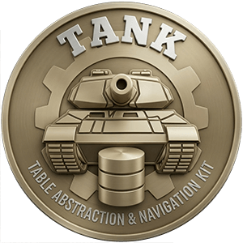

<div align="center">
    
</div>

# tank-chdb

`tank-chdb` is the chDB driver for [Tank](https://crates.io/crates/tank): the Rust data layer.

It maps Tank operations and queries to direct chDB commands. Use it with the main [`tank`](https://crates.io/crates/tank) crate, which provides entity definitions and the query API.

📘 **Docs:** https://tankhq.github.io/tank

🖥️ **Repo:** https://github.com/TankHQ/tank

📦 **Crate:** https://crates.io/crates/tank-chdb

## Features
- In-process SQL engine on top of ClickHouse via [`chdb-rust`](https://crates.io/crates/chdb-rust)
- Reuses the ClickHouse SQL dialect from [`tank-clickhouse`](https://crates.io/crates/tank-clickhouse)
- Streams results in `JSONCompact` chunks with column metadata

## Install
```sh
cargo add tank
cargo add tank-chdb
```

Optional feature flags:
- `bundled` (default): links `libchdb` statically, downloading prebuilt native artifacts at build time if not found locally (requires `libclang` and the platform C++ runtime).

Disable it to link a system `libchdb` dynamically instead:
```sh
cargo add tank-chdb --no-default-features
```

## Quick Start
```rust
use tank::{ConnectionPool, Driver, PoolConfig};
use tank_chdb::ChDBDriver;

let driver = ChDBDriver::new();
let pool = driver
    .connect_pool("chdb://?path=/path/to/database", PoolConfig::new())
    .await?;
let mut connection = pool.get().await?;
```

Run this inside an async function (use `"chdb://"` for an in-memory database). The returned connection can execute Tank entity operations.
