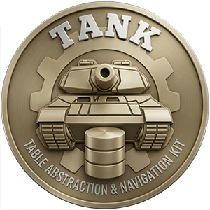

    

# tank-macros

Procedural macros for [**Tank**: the Rust data layer](https://crates.io/crates/tank).

This crate defines procedural macros used for code generation purposes. It exists in a separate crate to overcome a Rust build system limitation. For application development, depend on `tank` instead.

📘 https://tankhq.github.io/tank

🖥️ https://github.com/TankHQ/tank

📦 https://crates.io/crates/tank-macros
